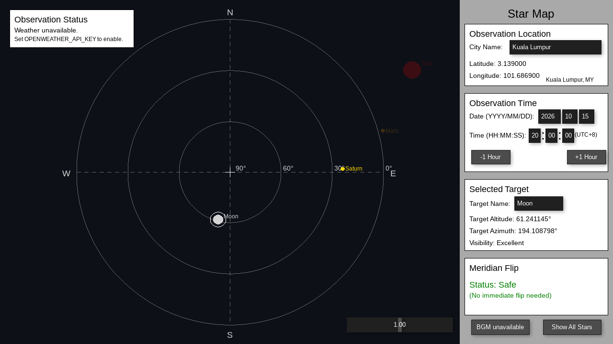

# Star Map

A C++ desktop sky map built with SplashKit for a FIT1045 High Distinction (HD) final coursework project.

Choose an observation city and local time, explore a catalog of celestial objects, and inspect a target's altitude, azimuth, visibility, and meridian warning. The project combines astronomical coordinate calculations with an interactive graphical interface.



## Features

- **Location and time:** select from 212 cities and move the observation time backward or forward by one hour.
- **Sky projection:** convert catalog right ascension and declination into altitude and azimuth using Julian date and local sidereal time.
- **Object catalog:** load 119 objects from CSV, with separate C++ classes for stars, planets, satellites, and deep-sky objects.
- **Target selection:** enter an object's name or click its plotted marker to inspect observation information.
- **Interactive display:** toggle the full catalog and zoom the sky map.
- **Optional weather:** retrieve cloud-cover forecasts from OpenWeather when an API key is configured.

## Build and run

Install the official [SplashKit SDK and SplashKit Manager](https://splashkit.io/installation/) for your operating system. These commands assume `skm` and the C++ compiler are available in your terminal.

Run from the repository's root directory:

```bash
skm clang++ -std=c++17 star_map.cpp gui.cpp utilities.cpp -o star-map
./star-map
```

On Windows, use the terminal provided by the official SplashKit setup and run `./star-map.exe`. Run the program from the repository root so the CSV files and `resources` folder can be found.

If SplashKit is already installed but `skm` is missing from PATH, try `~/.splashkit/skm` in place of `skm` on macOS or Linux. See the [official SKM documentation](https://github.com/splashkit/skm).

## Try an observation

The input fields start empty. Enter:

- City: `Kuala Lumpur`
- Date: year `2026`, month `10`, day `15`
- Local time: hour `20`, minute `00`, second `00`
- Target: `Moon`

City and object names are case-sensitive and must match the CSV files. Use **Show All Stars** to display the full catalog, the slider to zoom, and **-1 Hour / +1 Hour** to change the time. Press **Escape** or close the window to exit.

Dates must exist in the calendar, with a year from `1` to `9999`. Hours are `0–23`; minutes and seconds are `0–59`. Invalid input displays a warning instead of updating the observation. The hour buttons handle leap days and year rollover, and stop at the supported year limits.

Half-hour and quarter-hour timezone labels retain their minutes, for example Kathmandu's `UTC+5:45`. Faint objects have a minimum one-pixel marker so they remain visible and clickable.

## Regression checks

With SplashKit installed, run these commands from the repository root:

```bash
skm clang++ -std=c++17 tests/gui_regression.cpp gui.cpp utilities.cpp -o gui-regression
./gui-regression
```

On Windows, run `./gui-regression.exe`. The checks cover valid and invalid calendar dates, leap days, hour-button rollover and year limits, UTC-offset formatting, and marker sizes across the supplied catalog. They do not open a graphical window or call the weather service.

## Optional weather and music

The sky map runs without an API key. To enable weather, provide your own OpenWeather key in the launching terminal:

```bash
export OPENWEATHER_API_KEY="your-own-key"
./star-map
```

The application reads the environment variable directly; it does not load a `.env` file. If the key is absent or the service returns no forecast list, the interface displays **Weather unavailable**. Successful live weather retrieval has not been verified for this repository edition.

Background music is optional. To enable it locally, place an audio file you are permitted to use at `resources/sounds/background.mp3`. Audio files are ignored by Git. The music used in the original coursework is not included.

## Project structure

```text
star_map.cpp             Application entry point
star_map.h               Catalog loading and observation calculations
celestial_objects.h      Celestial object classes and rendering
gui.cpp / gui.h          Interactive graphical interface
utilities.cpp / .h       Input and utility functions
cities.csv               212 observation locations
star.csv                 119 celestial objects
resources/fonts/         Liberation Sans and its OFL license
docs/                    Design sketch and repository notes
```

The modular source files are used for the build. The original submission also contained a consolidated source file with the same implementation; that duplicate is omitted here.

## Coursework scope

This is an educational visualization. Catalog coordinates are fixed, including those for the Sun, Moon, and planets; the program does not calculate orbital ephemerides. Forecasts outside the available forecast window are approximated using available endpoints. Additional inherited limitations are listed in [repository notes](docs/REPOSITORY_NOTES.md).

The [original interface sketch](docs/images/design-sketch.jpg) records the design stage. The screenshot above was rendered from the repository edition using the sample inputs listed here, with weather and music disabled.

See [repository notes](docs/REPOSITORY_NOTES.md) for the changes made when preparing this coursework for GitHub, and [third-party notices](THIRD_PARTY_NOTICES.md) for dependencies and font attribution.
